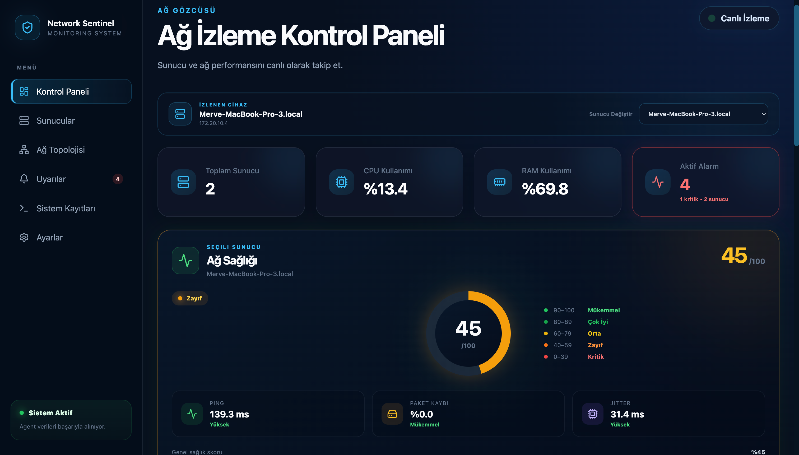
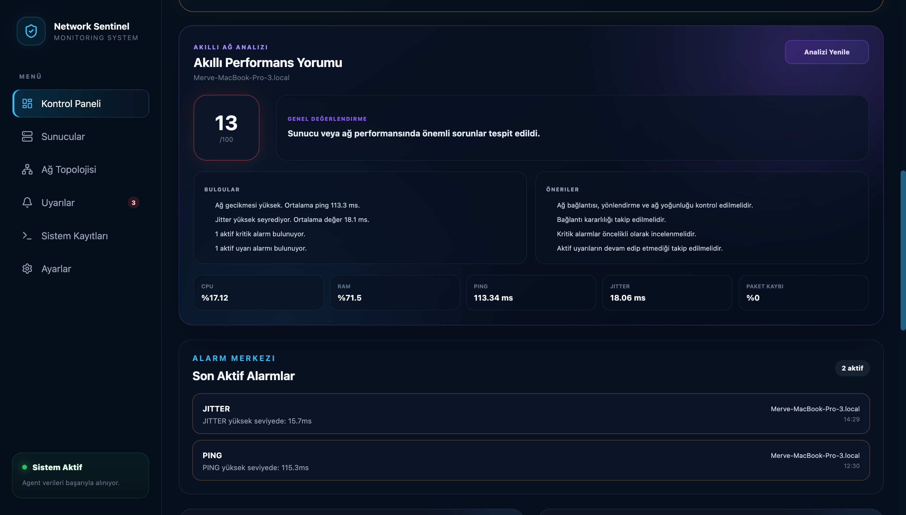
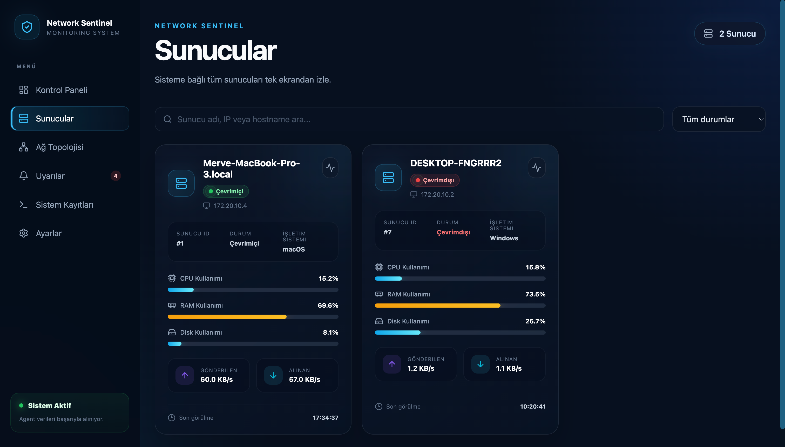
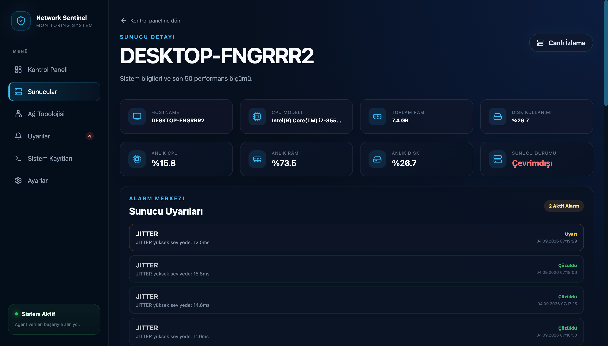
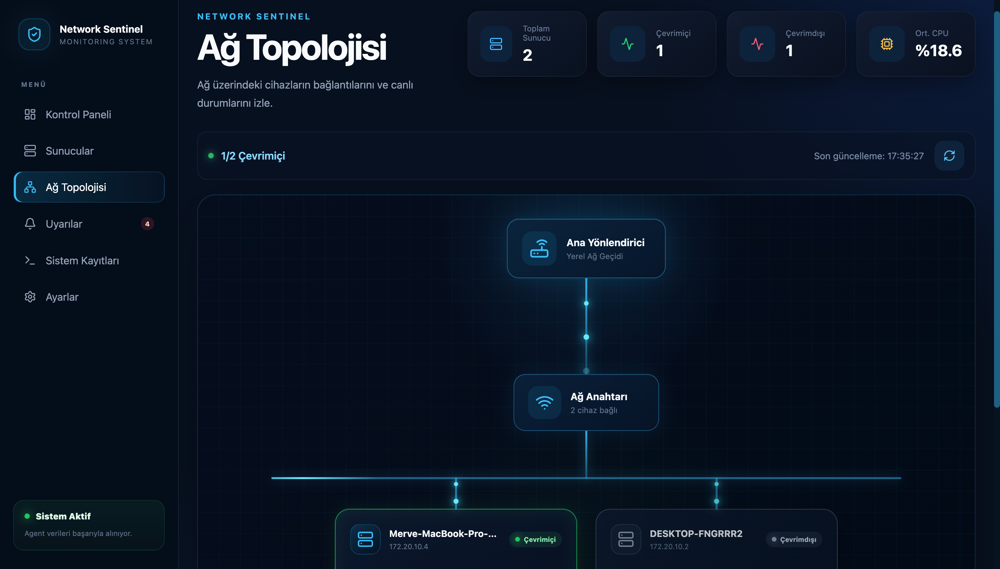
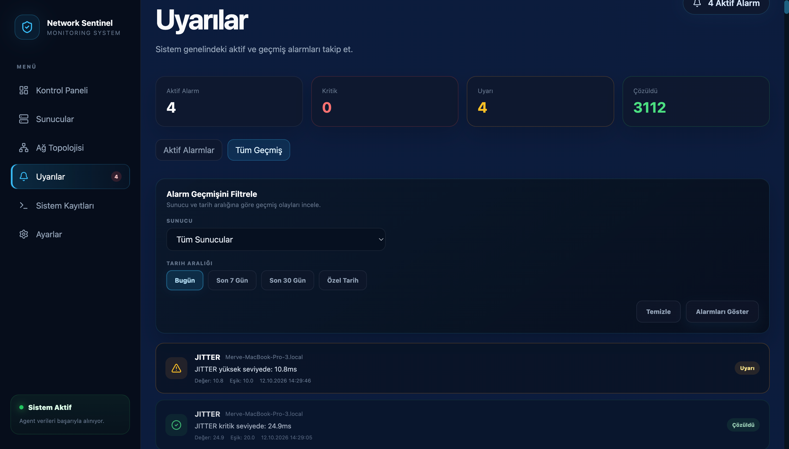
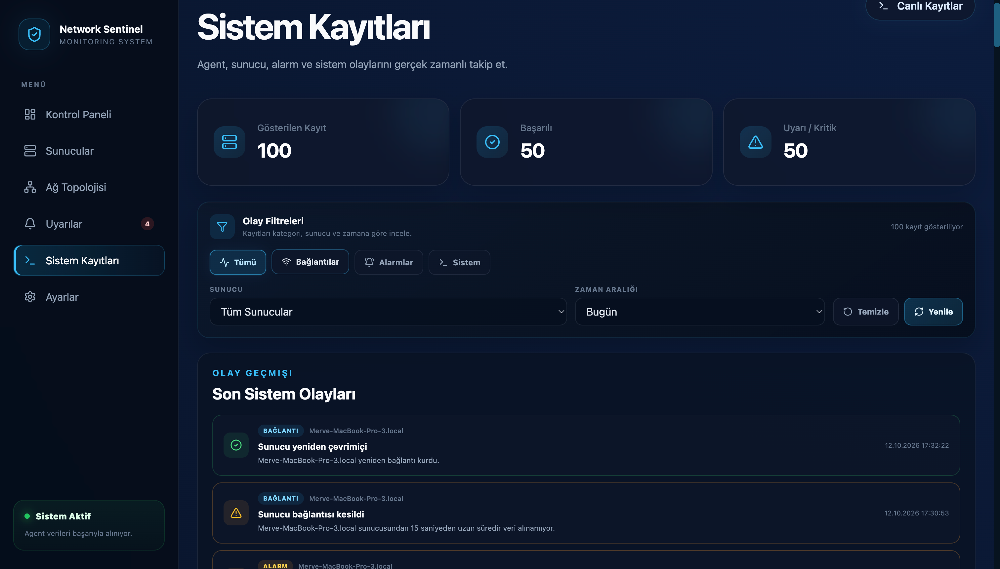
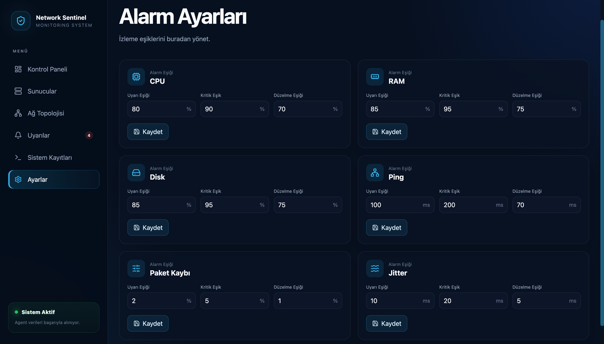

# 🛡️ Network Sentinel

**Sunucularınızın ve ağınızın sağlığını canlı olarak izleyen, sorunları siz fark etmeden önce haber veren bir izleme paneli.**

Network Sentinel; bilgisayar ve sunucuların işlemci, bellek, disk ve ağ kalitesi bilgilerini sürekli toplar, tek ekranda gösterir, eşikler aşıldığında alarm üretir ve durumu sade bir dille yorumlar.

> Bu depo projenin **tanıtım sayfasıdır**; kaynak kodu içermez.



---

## Ne işe yarar?

| Soru | Network Sentinel'in cevabı |
| --- | --- |
| Sunucularım şu an ayakta mı? | Çevrimiçi / çevrimdışı durumu anlık görünür. |
| Ağım yavaş mı, bağlantı kararsız mı? | Ping, paket kaybı ve jitter ölçülür ve 0–100 arası bir **ağ sağlık skoruna** dönüştürülür. |
| Sorun olduğunda nasıl haberim olur? | Eşik aşılınca **uyarı** veya **kritik** alarm oluşur, sorun bitince alarm kendiliğinden çözülür. |
| Ne yapmam gerekiyor? | **Akıllı Ağ Analizi** bulguları ve önerileri düz Türkçe ile listeler. |

---

## Özellikler

### 📊 Canlı Kontrol Paneli
Seçili sunucunun sağlık skoru, CPU / RAM kullanımı, ağ trafiği grafikleri ve aktif alarmlar tek sayfada. Veriler birkaç saniyede bir kendiliğinden yenilenir.


### 🧠 Akıllı Ağ Analizi
Son ölçümlerin ortalamasına bakarak genel değerlendirme, bulgular ve öneriler üretir. Aktif alarmlar skora yansır.



### 🖥️ Sunucu Yönetimi
Sunucular, üzerlerinde çalışan hafif ajan ilk kez bağlandığında kendiliğinden listeye eklenir. Ad, IP veya duruma göre arama ve filtreleme yapılır.



### 🔍 Sunucu Detayı
Donanım bilgisi (işlemci, RAM, işletim sistemi), anlık kullanım değerleri ve o sunucuya ait alarm geçmişi.



### 🗺️ Ağ Topolojisi
Yönlendirici → anahtar → sunucular şeklinde görsel harita. Her cihazın durumu renkle gösterilir.



### 🔔 Alarm Merkezi
Aktif alarmlar ve geçmiş; sunucuya ve tarih aralığına göre filtrelenebilir.



### 📜 Sistem Kayıtları
Bağlantı kopmaları, yeniden bağlanmalar ve alarm olaylarının zaman çizelgesi.



### ⚙️ Ayarlanabilir Eşikler
CPU, RAM, disk, ping, paket kaybı ve jitter için uyarı, kritik ve düzelme eşiklerini panelden belirleyin.



---

## Nasıl çalışır?

```
┌──────────────┐   birkaç saniyede bir   ┌──────────────┐    ┌──────────────┐
│    Ajan      │ ──────────────────────► │     API      │ ─► │  Veritabanı  │
│ (izlenen PC) │        ölçüm            │              │    │              │
└──────────────┘                         └──────┬───────┘    └──────────────┘
                                                │
                                                ▼
                                         ┌──────────────┐
                                         │  Web paneli  │
                                         └──────────────┘
```

1. **Ajan**, izlenen bilgisayarda çalışır; CPU, RAM, disk, ağ trafiği ve internet kalitesini ölçer.
2. **API**, ölçümleri alır, alarmları değerlendirir ve sunucuların çevrimdışı olup olmadığını denetler.
3. **Web paneli** bunları canlı olarak gösterir.

---

## Sağlık skoru

Skor 100'den başlar; gecikme, paket kaybı ve jitter arttıkça düşer.

| Skor | Anlamı |
| --- | --- |
| 90–100 | Mükemmel |
| 80–89 | Çok iyi |
| 60–79 | Orta |
| 40–59 | Zayıf |
| 0–39 | Kritik |

---

## Kullanılan teknolojiler

**Arayüz:** React · Vite · Recharts  
**API:** Python · FastAPI · SQLAlchemy  
**Veritabanı:** PostgreSQL · Alembic  
**Ajan:** Python · psutil  
**Altyapı:** Docker

---

## Yol haritası

- E-posta / mesajlaşma uygulaması üzerinden alarm bildirimi
- Kullanıcı girişi ve rol bazlı yetkilendirme
- Eski ölçümlerin otomatik temizlenmesi
- Docker ile tek komutta kurulum

---

👤 **Merve Özberk**
